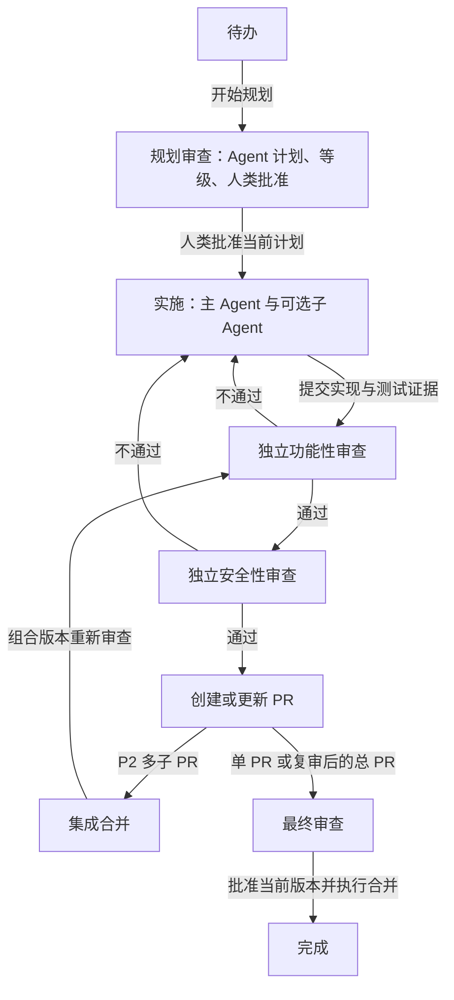

# 受控任务工作流

本页说明项目已实现的看板流程。它由本地工作流服务保存计划、角色绑定、审批和版本证据，Vibe Kanban 提供任务、会话与 worktree。Ralph 可用于协调批次，但不代替流程门禁。启动方式见 [README](../../../README.md)。

## 从待办到合并

新任务只创建待办。在卡片点击“规划任务”，再点击“开始任务并授权规划”。规划 Agent 产出计划、等级依据和子任务，人类在“规划审查”面板审核批准当前版本，不能手工代填计划或等级。规划本身包含审查，不增加另一个规划审查 Agent。所有等级都需要此批准。

流程不会仅因 Agent 退出、卡片移动、没有审查评论或 CI 通过而宣布完成。开始授权并批准计划后，后台自动收集结果，按依赖完成子任务，再运行主实施、独立双审、必要返工、PR 发布及 P2 集成复审。服务运行时即使没有浏览器也会推进；最终版本批准与合并仍由人类明确操作。

| 阶段 | 必须满足的条件 | 留下的记录 |
| --- | --- | --- |
| 规划审查 | Agent 计划包含范围、验收、P0～P3 等级和依据；人类批准保存后的计划版本 | 计划版本、任务快照、子任务依赖、批准时提示词 |
| 实施 | 当前计划已批准；使用规划时的主会话 | 工作区、提交版本、实际测试结果、阶段摘要 |
| 功能性审查 | 实施结束；独立于所有实施者 | 覆盖版本、验收与测试证据、通过或打回结论 |
| 安全性审查 | 当前版本功能审查通过；独立于实施者和功能审查者 | 权限、输入、数据等风险检查及结论 |
| 创建 PR | 当前候选的两项审查均通过，工作区没有未提交修改 | 真实 GitHub PR、来源与目标分支、精确版本 |
| 集成合并 | P2 的待发布子 PR 已齐备，依赖及版本核验通过 | 独立集成工作区、子 PR 映射、组合版本 |
| 最终审查 | 单 PR 或集成后复审的总 PR 已准备好 | 人类对当前候选版本的批准 |
| 完成 | 明确执行合并，远端确认 PR 已实际合并 | 合并结果；排队中或结果未知不算完成 |

## Agent 与提示词

规划和实施共用一个主 Agent 会话。实施可以使用计划中登记的多个子 Agent，各自拥有独立工作区；功能性审查和安全性审查各有一个独立会话，不能复用主实施会话、实施子会话或对方的审查会话。

已批准的实施阶段关闭 CLI 交互审批，允许执行计划内操作；规划和两项审查仍使用 Claude Code 的只读工具配置。审查读取代码与已有测试证据，不在审查会话中执行测试或修代码。证据不足应打回实施；安全问题同样交给实施者修复，然后重新走两项审查。

“设置”提供规划、实施、功能性审查、安全性审查的项目默认提示词，任务详情可以覆盖。计划批准时冻结各阶段提示词；修改模板不会改变已经批准的执行，下一次计划批准时才生效。每次启动保存实际提示词和输入版本，供之后追溯。

任务正文、计划或代码版本发生变化时，旧批准和相应审查结果不能继续用于新内容。修改后的计划须重新批准；返工或集成后的新版本须重新审查。

## 等级与 P2 子 PR

等级描述变更风险，不是排期优先级。定义见 [风险等级](../SKILL.md#变更风险与审批等级)。所有等级都保留计划人工批准和最终人工批准，P3 也不免除这两个步骤。

规划 Agent 可为 P2 子任务指定发布独立子 PR，记录目标分支及依赖，由人类随计划整体批准。非发布子任务是实施协作者，由主实施 Agent 把实际提交汇入主工作分支后统一审查；P0、P1、P3 的实施子任务使用这种方式。

有依赖的发布子任务从实际前驱分支开始；无依赖子任务可以独立实施。多个 P2 子 PR 齐备后，“集成合并”按依赖顺序在新的集成工作区组合提交，不在此合入最终目标分支。组合版本重新经过功能性和安全性审查，再创建或更新总 PR，进入最终人类审查。单个 PR 不额外增加集成步骤。

集成冲突会报告失败并保留诊断信息，不能当作成功。集成复审打回后，主实施 Agent 修复集成工作区，再重新进行两项审查。

## 卡片与历史

待办仍显示任务标题和正文；其他阶段显示阶段摘要。“规划审查”面板只展示任务、Agent 计划、等级依据与计划批准；“最终审查”面板展示最终候选、双审证据、PR 与最终批准合并，不混入计划编辑或批准。中间阶段使用执行进度面板。P0～P3 标记从规划开始显示，历史节点保留当时的等级。

蓝线表示顺序或整合关系，红色虚线表示返工；悬停或键盘聚焦可查看含义。折叠历史、关系筛选、任务关联和路径显示收进“设置”。历史卡片不会创建额外工作任务，刷新后仍可查看。原生状态留痕说明见 [流程追踪](workflow-tracking.md)。

## 批次、停止与恢复

`kanban_batch.py` 仍负责校验、导入和推荐就绪任务。它的 `ready` 结果不包含计划批准，也不授权启动实施。导入后仍须在受控流程中规划和批准。后台限制受控工作会话最多 3 个并发；批次依赖、费用和跨任务资源锁仍需要协调者核对，当前服务不是完整的全局资源调度器。

恢复前核对任务、会话、实际执行进程、分支及 PR 版本。启动结果未知时先查已创建会话，避免重复启动。“暂停自动执行”仅停止新派发，不杀死已运行 Agent；核对原因后点击“恢复自动执行”明确恢复。运行中工作者若需停止须另行操作。关闭页面或取消 Ralph 不会暂停后台工作流或停止工作者。发现权限不足、缺失仓库、未提交变更或远端状态不符时，修复对应条件后重试，不手工改数据库绕过门禁。

当前计划自上次明确恢复以来累计三次未通过的阶段结果后，后台暂停自动返工并保留原因。人类检查后可明确恢复下一段尝试，历史记录不会清除。全局费用上限仍由协调者管理。合并后的复盘可以另行安排，不是当前“完成”状态的自动前置步骤。

## 支持范围与验收边界

- 受控阶段目前仅支持本机 Claude Code。Codex 本地 CLI 接入仍保留，但外部 MCP 工具隔离未完成验证，不能用于此受控流程。
- 当前自动 PR、集成及合并路径面向单仓库 GitHub 项目，需要本机 Git 和已授权的 GitHub CLI。多仓库或其他托管平台不在本次支持范围。
- HTTP 入口检查同源请求，SQLite 启动许可拦住绕过阶段的原生执行入口。这是应用级门禁，不是不同操作系统用户之间的隔离，也不能证明同一 OS 用户发起的请求必然来自真人。
- 自动测试覆盖状态、会话隔离、版本门禁、Git 编排和浏览器交互；模型与 GitHub 操作使用模拟边界。真实模型执行、远端 PR 创建、集成发布和最终合并尚未完成端到端验收。
